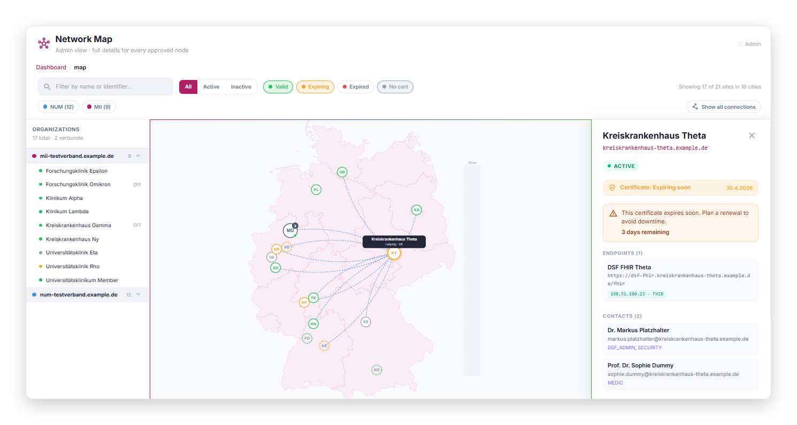
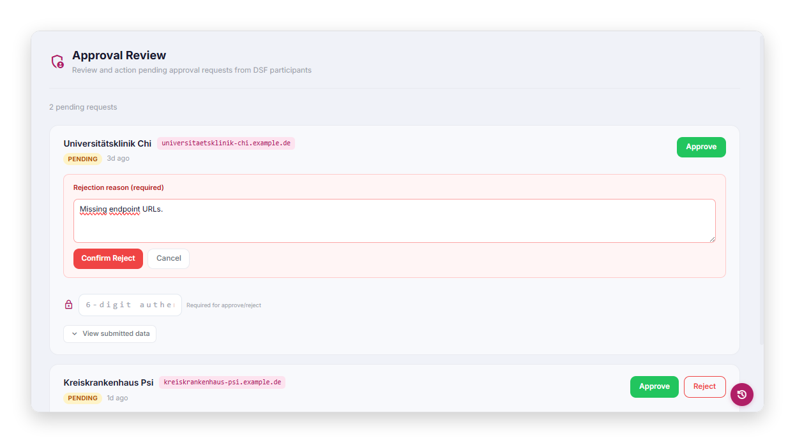

<picture>
  <source media="(prefers-color-scheme: dark)" srcset="docs/logo-dsf-management-dark.svg">
  
</picture>

# DSF Management Tool

Management platform for the [Data Sharing Framework](https://dsf.dev) (DSF) networks of the German Medical Informatics Initiative (MII) and the Network University Medicine (NUM). Sites maintain their organization, endpoints, certificates and memberships; administrators review and approve changes and publish them as the signed DSF allow list. Around the allow list the tool covers certificate lifecycle and CA policy, security incidents with NIS2 reporting, a marketplace for DSF process plugins, a network map, audit and backups, and an API for automated certificate renewal.

<a href="https://www.medizin.uni-muenster.de/imi/das-institut.html">
  <picture>
    <source media="(prefers-color-scheme: dark)" srcset="frontend/public/logos/IMI-Logo-grad-eng-dark.png">
    
  </picture>
</a>

Operated by the [Institute of Medical Informatics](https://www.medizin.uni-muenster.de/imi/das-institut.html), University of Münster.

## Features

- **Site data on one page.** Organization, contacts, endpoints, certificates and memberships of a DSF instance, with their relations.
- **Four-eyes approval.** A change reaches the allow list only after two administrators from different sites approve it, or one approves and nobody objects for seven days.
- **Versioned allow list.** Every published version is kept, with diff, signed download and a four-eyes restore.
- **FHIR bundle for the DSF.** The BPE process `downloadAllowList` fetches the RS256-signed bundle over mTLS.
- **Sign-in.** Client certificate, or e-mail one-time code plus TOTP. The DSF certificate of a site becomes its login once it is on the approved allow list.
- **Request review.** Each pending request carries a risk assessment (certificate, CA, endpoint, contact and network changes) summarised for the reviewing admins.
- **Certificates.** Per certificate a site decides whether it is published in the allow list, used for login, or both; uploads are checked against the CA white- and blacklist.
- **Security incidents.** Report, confirm, suspend a site and block its certificates, NIS2 reporting stages, false alarms with two-admin lifting of blocks, hash-chained incident log.
- **Site lifecycle.** Bulk onboarding from CSV/XLSX and removal of a whole site with two admin confirmations; the next allow-list version deletes it at every DSF instance.
- **Marketplace** of DSF process plugins, synchronised with their GitHub repositories.
- **Administration.** Users and admin roles, statistics, scheduled backups, audit log with export.
- **Network map** of all sites and their networks.
- **Automation API.** Sites can renew client certificates via the API, see below.

<table>
<tr>
<td width="33%"><a href="docs/screenshots/01-canvas.png"></a></td>
<td width="33%"><a href="docs/screenshots/02-map.png"></a></td>
<td width="33%"><a href="docs/screenshots/03-admin-approval.png"></a></td>
</tr>
</table>

## Quick start

Requires Docker and Git.

```bash
git clone https://github.com/Mukeyii/num-dsf-allowlist.git
cd num-dsf-allowlist
cp .env.example .env
bash scripts/generate-keys.sh
docker compose up -d
docker compose exec backend npx ts-node src/db/seed-whitelist.ts admin@example.com
docker compose exec backend npx ts-node src/db/seed-testdata.ts   # optional demo data
```

The portal runs at <http://localhost>, the API at <http://localhost/api/v1>, and the development mailbox (Mailhog) at <http://localhost:8025>.

## Development

```bash
docker compose exec backend npm test     # backend tests (Jest, needs the stack)
cd frontend && npm test                  # frontend tests (Vitest)
cd frontend && npm run test:e2e          # Playwright end-to-end tests (needs the stack)
cd frontend && npm run test:contract     # contract tests against the real backend
```

Type-check with `npx tsc --noEmit` in `backend/` and `frontend/`. Commits follow Conventional Commits; the git hooks (husky) run Prettier, commitlint and, if installed, gitleaks. See [`CONTRIBUTING.md`](CONTRIBUTING.md).

```
frontend/        React, TypeScript, Vite, Tailwind
backend/         Node.js, Express, TypeScript
db/migrations/   MySQL 8 schema (idempotent SQL)
nginx/           reverse proxy configurations
scripts/         key generation, server update, backup and restore
docs/            guides, ADRs, screenshots
```

## Deployment

Production runs with Docker Compose behind a TLS-terminating reverse proxy. Installation, updates, environment variables, migrations, certificate sign-in, and backup and restore are described in [`docs/DEPLOYMENT.md`](docs/DEPLOYMENT.md); running from the released images in [`docs/RUN-FROM-IMAGE.md`](docs/RUN-FROM-IMAGE.md).

## Automation: renew client certificates via the API

Sites can renew their DSF client certificate before it expires without the web UI. Authenticate with the current client certificate (mTLS) at `POST /auth/client-cert-login`, upload the new certificate with `POST /api/v1/instances/:id/certificates/:cid/renew` and submit the approval request. Admins still approve it (four-eyes). The old certificate keeps working until it expires, so renew ahead of time.

`scripts/site-cert-renew.sh` does this and renews when less than 30 days are left; `--dry-run` only reports:

```sh
scripts/site-cert-renew.sh --base-url https://dsf.example.org --cert cur.pem --key cur.key --new-cert new.pem --dry-run
```

Endpoints, error codes, rate limits and the stability promise: [`docs/automation.md`](docs/automation.md).

## Documentation

| Topic | Where |
|---|---|
| Getting started, admin guide, FAQ | [`docs/wiki/`](docs/wiki/) |
| API reference | [`docs/wiki/API-Reference.md`](docs/wiki/API-Reference.md) |
| Architecture and decisions | [`docs/wiki/Architecture.md`](docs/wiki/Architecture.md), [`docs/adr/`](docs/adr/) |
| Database schema and migrations | [`docs/database/`](docs/database/) |
| Security policy | [`SECURITY.md`](SECURITY.md) |

## Security

Sessions use RS256-signed JWTs with revocable refresh tokens. Sensitive admin actions need a fresh second factor. Uploads containing a private key are rejected and never logged, the audit log is append-only, and contact data is never published in the allow list. Report vulnerabilities privately as described in [`SECURITY.md`](SECURITY.md).

## License

Apache 2.0, see [`LICENSE`](LICENSE). Institute of Medical Informatics, University of Münster.
